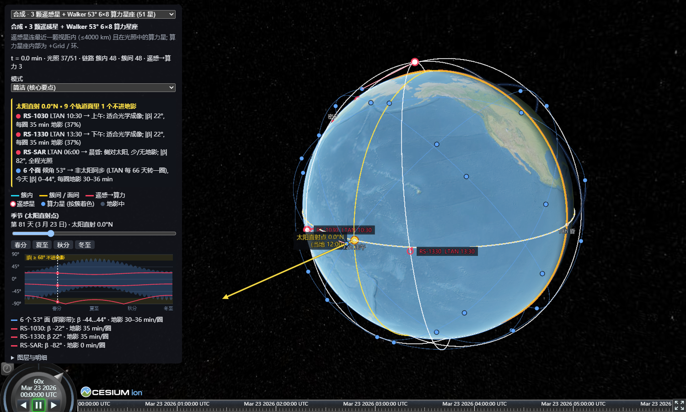
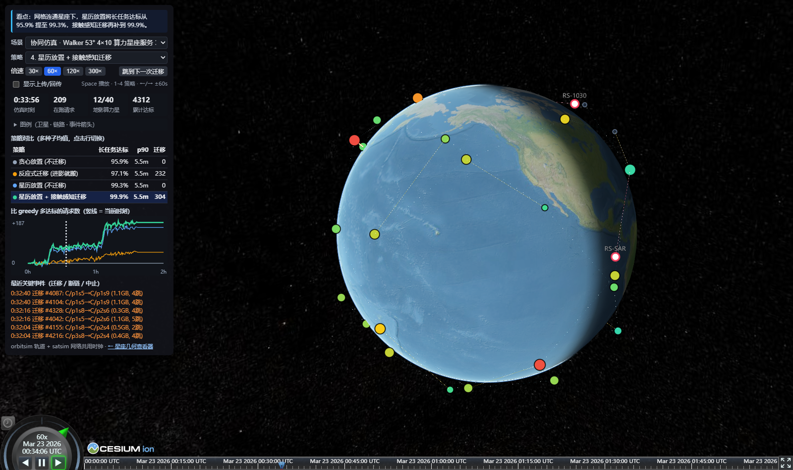

# viz — orbitsim 3-D 星座查看器

在地球上画 orbitsim 场景的轨道、卫星、星间链路，以及帮助理解轨道几何的辅助线。基于 CesiumJS，
纯前端，离线可用（地图用 Cesium 自带的 Natural Earth 瓦片，不需要 ion token）。



## 快速开始

```bash
cd viz
npm install            # 第一次
npm run export         # 用 orbitsim 导出内置场景到 public/scenarios/ (需要 uv)
npm run dev            # 打开 http://localhost:5288/
```

`?s=<场景名>` 直接打开某个场景，例如 `http://localhost:5288/?s=sow-sso2`。

其他命令：

| 命令 | 作用 |
|---|---|
| `npm test` | TS 传播与 Python 参考点逐点对比 (< 1 m)、LTAN / β / 地影弧 / 赤纬及回放辅助函数测试 |
| `npm run check` | TypeScript 类型检查 |
| `npm run build` | 打包到 `dist/`，任何静态服务器都能托管 (`npm run preview` 本地看) |
| `npm run shot -- <url> <输出目录> <场景,场景> [第几天]` | 无头截图；没装 Playwright 浏览器时加 `SHOT_CHANNEL=chrome` |

端口用 `PORT=xxxx npm run dev` 改。

## 协同仿真回放 (`play.html`)

打开 `http://localhost:5288/play.html`（支持 URL 参数 `?p=<回放名>&pol=<策略>&t=<秒>`）。轨道由 orbitsim 闭式解实时计算，星间链路、请求负载、KV 迁移与断链事件来自 satsim 的协同仿真记录，两者共用同一个仿真时钟。实验设计与结论见 satsim `docs/notes/cosim_contact_trace.md`。



**视觉元素含义**

| 元素 | 画面表现 | 含义 |
|---|---|---|
| 遥感星 (RS) | 白点红框 + 标签 | 发起推理请求，结果必须经星间链路传回同一颗星 |
| 算力星 | 彩色圆点 | 大小 = 正在解码的请求数；颜色（青→绿→黄→红）= 显存占用；进地影变暗并带灰框（限功 0.35×） |
| 星间链路 | 青 / 黄 / 红细线 | 青 = 面内（空闲时暗淡）、黄 = 跨面、红 = 遥感→算力；在传数据时变粗变亮橙色 |
| 事件箭头 | 橙 / 红 / 绿 / 蓝箭头 | 橙色粗箭头 + 移动圆点 = KV 迁移；红圈/红箭头 = 断链或迁移中止；上传（绿）/回传（蓝）默认隐藏，可勾选"显示上传/回传"开启 |

**交互与快捷键**

- `Space`：播放 / 暂停
- `1`–`4` 或点击策略对比表行：切换四种调度策略（`greedy` / `reactive` / `ephemeris` / `contact_aware`）
- `←` / `→`：仿真时间退 / 进 60 秒
- **跳到下一次迁移**：将时钟直接拨到当前时刻之后的下一条 KV 迁移事件

**重新生成回放数据**

```bash
# 在 satsim 仓库下运行，写出 public/playback/<name>.json 并更新 index.json
uv run satsim-cosim configs/cosim_coop_w53_v1.yaml --viz ../orbitsim/viz/public/playback
uv run satsim-cosim configs/cosim_coop_sso2_v1.yaml --viz ../orbitsim/viz/public/playback
```

## 页面里有什么

**卫星与链路**

- 算力星按簇着色，遥感星是白点红边；进入地影变灰。
- 链路：青色 = 簇内 / 同面，黄色 = 簇间 / 面间，红色 = 遥感星 → 最近一颗亮的算力星。
  动态链路每帧按距离和视线（高于地表 80 km）重新判断；有一端在地影里的链路变暗。
- 左上角实时显示时间、光照星数、各类链路条数。点卫星看高度、倾角、LTAN、周期。

**简洁 / 详细模式**（面板顶部切换，默认简洁；`?m=detail` 直接打开详细）

简洁模式只留回答三件事的线：太阳在哪、每个轨道面怎么朝着太阳、每条轨道在哪里丢掉光照。

| 简洁模式保留 | 只在详细模式出现 |
|---|---|
| 晨昏线、太阳箭头、太阳直射点和它今天走的纬线 | 南北回归线、"太阳方向"文字 |
| 赤道环 + 0h / 6h / 12h / 18h 四个刻度 | 每小时刻度 |
| 06:00、12:00、18:00 三条地方时经线（不带文字） | 全部 6 条经线和文字 |
| 每个轨道面一条轨道线、地影弧 | 每颗星一条轨道线 |
| 升交点圆圈 + 短标签（LTAN）+ 连到赤道刻度的辐条 | 带 β 的长标签、降交点、交点线 |
| 有遥感星时：只标遥感星的轨道面；算力星座的固定网格链路隐藏，只留遥感→算力的动态链路 | 所有轨道面、全部链路 |
| β 图里非太阳同步壳画成一条阴影带（各面 β 的范围） | 每个面一条线 |

面板最上面的**要点**框每个场景自动生成：当天直射纬度、几个面不进地影，然后每类轨道面一行，
写它的 LTAN 意味着什么（晨昏 / 上午 / 下午 / 正午子夜）、|β|、每圈地影。同一个星座里光照条件相同的面合并成一行；
非太阳同步的壳（如 53°）标出 LTAN 多少天转一圈，因为它的 LTAN 只是当天的快照。

复选框和轨道面表收在"图层与明细"里。

**辅助线**（"图层与明细"里逐项开关）

| 开关 | 画的是什么 | 怎么读 |
|---|---|---|
| 地方时经线 | 00:00 / 06:00 / 10:30 / 12:00 / 13:30 / 18:00 六条经线 | 相对太阳固定，地球在下面转；12:00 在太阳正下方 |
| 太阳 & 晨昏线 | 昼夜分界大圆 + 指向太阳的箭头 | |
| 赤道 & 交点 | 赤道环 + 0–23h 地方时刻度；每个轨道面的升交点（实心辐条连到刻度）、降交点（空心圈）、交点线（虚线） | 升交点下的刻度读数就是 LTAN，降交点差 12 h |
| 升交点 LTAN | 升交点圆圈，标签写这个面上的簇、LTAN、β | |
| 地影弧段 | 每条轨道被地球挡住的那一段（深色粗线） | |
| 太阳直射点 | 黄点 = 直射点（当地正午、纬度 = 太阳赤纬）；黄虚线 = 它今天沿着走的纬线；橙线 = 南北回归线 | |

**季节**

- 日期滑块（0–364 天）和春分 / 夏至 / 秋分 / 冬至按钮。换日期时，太阳赤纬变，
  每个轨道面按自己的 J2 漂移跟着走：SSO 面 LTAN 不变，53° 面每天退行约 5°。
- β 曲线图：每个轨道面 β 角的全年变化，黄色带是不进地影的区间（|β| ≥ asin(RE/r)），
  竖虚线是当前日期；图下列出当天每个面的 β 和每圈地影分钟数。
- 轨道面表：每个面的 LTAN、β、每圈地影、类型（晨昏 / 上午 / 下午 / 正午子夜）。

**惯性视角**：相机随惯性系转，轨道面和晨昏线不动、地球在下面转，最容易看出 LTAN 是轨道面相对太阳的固定朝向。

## 内置场景

| 名字 | 内容 | 来源 |
|---|---|---|
| `sow-sso4` | 4 个 SSO 面 (LTAN 0/6/12/18)，各 1 簇 × 4 星 | `research_sow_events.py` |
| `sow-sso2` | 2 个 SSO 面 (10:30 / 13:30)，每面 2 簇相隔 180° | 同上 |
| `sow-w53` | 4 个 53° 面，各 1 簇 | 同上 |
| `sow-relay` | 1 个 SSO 面，每 40° 一簇 (9 簇 × 2 星)，同面接力 | 同上 |
| `synth-w53` | 3 颗遥感星 + Walker 53° 6×8 | `research_synth_fleet.py` |
| `synth-dawn-dusk` | 3 颗遥感星 + 晨昏面 12 星 | 同上 |
| `synth-coplanar` | 3 颗遥感星 + 与 RS-1030 同面伴飞 6 星 | 同上 |

## 加自己的场景

在仓库根目录写个脚本，用 `fleet_synth` 造卫星，调 `export_viz.export_scenario`：

```python
import sys; sys.path.insert(0, "src")
from orbitsim import fleet_synth as fs
from export_viz import export_scenario

rs = [fs.make_sat("RS-1030", 500, ltan_h=10.5, role="rs")]
compute = fs.walker("C", planes=6, spp=8, alt_km=550, inc_deg=53.0, F=1)   # role="compute"
for s in compute:
    s["cluster"] = f"面{s['plane']}"          # 颜色按 cluster 分
links = [[f"C/p{p}s{k}", f"C/p{p}s{(k + 1) % 8}", "intra"] for p in range(6) for k in range(8)]

export_scenario(
    "my-w53", "我的 Walker 53°", rs + compute,
    links=links,                                  # 静态链路, 一直画
    dynamic=[{"a": "rs", "b": "compute", "kind": "rs", "max_range_m": 4e6,
              "grazing_m": 8e4, "nearest_only": True, "require_lit_b": True}],
    doy=172,                                      # 打开时是哪一天 (0 = 1 月 1 日)
    description="页面上显示的一句说明",
)
```

然后刷新页面，下拉框里就有它。`export_scenario` 会更新 `public/scenarios/index.json`，同名场景直接覆盖。

参数：

| 参数 | 说明 |
|---|---|
| `sats` | `fs.make_sat` / `fs.walker` / `fs.sso_plane` 的记录。`role="rs"` 画成遥感星；`cluster`（没有就用 `plane`）决定颜色和"不同簇"的判断；`group`（没有就用 `role`）给动态链路规则挑两端 |
| `links` | `[[a, b, kind], ...]` 按卫星名，kind 为 `intra` / `inter` / `rs` |
| `dynamic` | 每帧重算的链路规则：`a` / `b` 是两端的 group；`max_range_m`、`grazing_m`（视线最低离地高度）；可选 `nearest_only`（每个 a 只连最近的 b）、`require_lit_b`（b 必须在光照中）、`different_cluster`（只连不同簇） |
| `doy` | 打开时的日期；页面滑块可以再换 |
| `stations` | 是否画地面站（密云 / 喀什 / 三亚 / 基律纳） |
| `duration_h` | 时间轴长度 |

## 模型和精度

和 orbitsim 同一套闭式模型：圆轨道、球形地球 (RE = 6378.135 km)、J2 长期 RAAN 漂移、平太阳
（赤纬 23.44°·sin(2π(doy−81)/365.2422)）、圆柱地影。场景内太阳固定在当天，换日期用滑块。

- `src/scenario.ts` 是 `orbitsim.fleet_synth` 的 TypeScript 移植，不依赖 Cesium。导出的每个场景带一组
  Python 算出的参考位置和光照（`check` 字段），`npm test` 逐点比对，差 < 1 m。
- 地球上的明暗是 Cesium 按真实太阳画的，和平太阳差几度（时差方程），所以地球阴影边界和卫星变灰的时刻可能差一两分钟。
- 不是 SGP4，不画真实 TLE 卫星；要看真实卫星用 satvis 原版。

## 文件

| 文件 | 内容 |
|---|---|
| `play.html` / `src/play.ts` | **协同仿真回放**：satsim 按 orbitsim 接触轨迹跑出的网络事件（链路负载、上传、KV 迁移、断链、结果回传）叠在同一时钟的星座上；`src/playback.ts` 是不依赖 Cesium 的部分 |
| `public/playback/` | 回放 JSON，由 satsim `satsim-cosim <config> --viz ../orbitsim/viz/public/playback` 生成 |
| `shot_play.mjs` | 回放页无头截图：`node shot_play.mjs <url> <目录> <回放名> <策略> <t1,t2>` |
| `index.html` | 页面和面板 |
| `src/main.ts` | Cesium 绘制：卫星、链路、辅助线、季节滑块、β 图 |
| `src/scenario.ts` | 传播、地影、视线、LTAN / β、地方时、太阳直射点（无 Cesium，可单测） |
| `src/scenario.test.ts` | 与 Python 参考点和 orbit_sun 闭式解的对比测试 |
| `shot.mjs` | 无头截图 |
| `public/scenarios/` | 导出的场景 JSON（由 `../export_viz.py` 生成） |

最初的页面在 [Flowm/satvis](https://github.com/Flowm/satvis)（MIT）上做原型，现已独立，不再依赖它。
